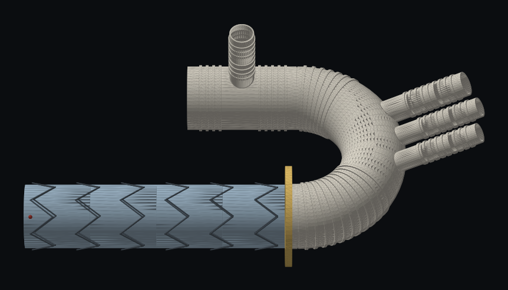
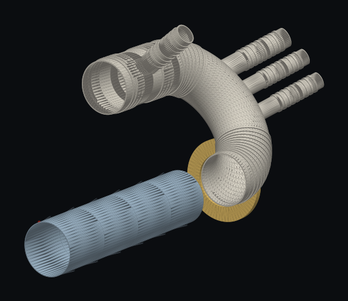
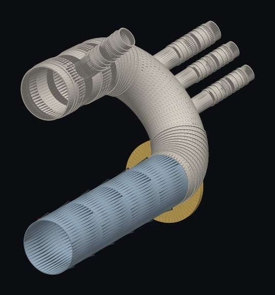

# Frozen Elephant Trunk Hybrid Graft

A full CAD model of a frozen elephant trunk (FET) hybrid prosthesis for aortic arch replacement. One device, five components: a branched arch graft, a sewing collar, a stented trunk, six nitinol Z-stents and four radiopaque markers. Built in Fusion 360.



## The problem

Acute aortic dissection is rare and brutal. UK estimates put it at about 7 to 10 cases per 100,000 people a year, and an untreated type A dissection kills roughly 1% of patients every hour ([British Journal of Cardiology, 2023](https://bjcardio.co.uk/2023/03/acute-aortic-dissection-aad-a-lethal-disease-the-epidemiology-pathophysiology-and-natural-history/)).

When the tear runs through the arch and down into the descending aorta, fixing only the ascending part leaves disease behind. Surgeons often have to go back in. The frozen elephant trunk was built for this. It replaces the arch with a fabric graft and pushes a stented tube into the descending aorta in the same operation.

In a 307-patient series from Essen, Germany, freedom from reintervention after FET in acute type I dissection was 87% at 5 years and 74% at 10 years. Proximal repair alone got 68% and 48% ([Jakob et al., Annals of Cardiothoracic Surgery, 2020](https://www.annalscts.com/article/view/16732/html)).

It is still a major operation. That same series reported 12% 30-day mortality, 7% permanent stroke and 3% paraplegia (Jakob et al., 2020). Device design matters here. Branch layout, stent length and how the trunk lands in the descending aorta all affect those outcomes.

## The solution

This model breaks the hybrid graft into its real parts, each one its own body in Fusion with its own material:

- **Arch graft** (woven PET with gelatin seal). Replaces the arch. Three head-vessel branches and one perfusion side arm.
- **Sewing collar** (PET). The ring the surgeon sutures to the distal aorta.
- **Stented trunk** (PET fabric). The tube that goes down the descending aorta.
- **Z-stents** (nitinol). Six rings inside the trunk that open it against the vessel wall.
- **Markers** (platinum-iridium). Four small beads that show up on imaging so the trunk can be placed.



Having each part as its own body means you can measure, resize or swap any one of them without touching the rest.

## Key characteristics

- **Complete device.** Arch, collar, trunk, stents and markers in one assembly.
- **Branched arch.** Three separate head-vessel branches plus a perfusion side arm.
- **Real materials assigned.** PET, gelatin-sealed PET, nitinol and Pt-Ir are named on every body.
- **Thin walls to scale.** 0.6 mm arch wall, 0.3 mm trunk fabric, 0.6 mm stent wire.
- **Open formats.** Native Fusion source plus STEP and STL.
- **Measured from the mesh.** Every number below comes from the STL (`scripts/measure.py`).

## Specs

Overall envelope: 82.8 x 206.4 x 109.4 mm. 14 bodies, 143,448 triangles.

| Part | Count | Key dimensions (mm) | Volume (cm³) |
|---|---|---|---|
| Arch graft | 1 | 28.0 ID, 29.2 OD, 134.4 long | 13.88 |
| Head-vessel branches | 3 | one 10.9 ID, two 8.7 ID | part of arch |
| Perfusion side arm | 1 | 15.6 ID | part of arch |
| Stented trunk | 1 | 28.0 ID, 28.6 OD, 118.0 long | 3.15 |
| Sewing collar | 1 | 45.2 OD, 29.2 ID, 3.0 thick | 2.80 |
| Junction piece (arch graft material) | 1 | 24.3 dia, 6.5 thick | 0.34 |
| Z-stents (nitinol) | 6 | 30.6 OD, 10.5 tall, 0.6 wire, 20 mm spacing | 0.03 each |
| Markers (Pt-Ir) | 4 | 1.6 dia | under 0.01 each |



## Impact

Who it helps: patients with acute or chronic type A dissection, or aneurysms, that reach from the arch into the descending aorta. Also students and engineers who want to see how a hybrid graft is put together part by part.

Two commercial FET devices, E-vita Open and Thoraflex Hybrid, were compared in a meta-analysis of 2,161 patients (Harky, Fok and Bashir, 2020, cited in Jakob et al., 2020). Pricing for either is not public in these sources, so this repo makes no cost comparison.

This is a design model. It is a starting point for sizing studies, flow simulation and teaching.

## Repo layout

```
cad/fusion/   Fusion 360 archive (.f3d)
cad/step/     STEP file
stl/          STL mesh
scripts/      measure.py (dimensions), render.py (images)
renders/      Images
docs/         Design notes and part breakdown
testing/      Checks done and planned
```

## How to print

Walls are true to scale: 0.3 to 0.6 mm. A desktop FDM printer cannot print that as is.

1. For a display model, thicken the arch and trunk walls to at least 1.2 mm in Fusion first, or use a resin printer.
2. Print the arch graft and trunk separately. Hide the stents and markers for a first print.
3. For a resin print, use 0.05 mm layers and support the branches from below.
4. Glue the trunk into the collar to assemble.

## Status and next steps

Status: CAD model complete in one size. Not printed. No simulation yet.

Next:
- Add size variants for trunk diameter and length
- Run a CFD flow study through the arch and branches
- Resin print a thickened display model
- Get feedback from a cardiovascular surgeon

## Author

Carlos Ortega, Biomedical Engineering, Florida State University

## Disclaimer

Not a certified medical device. For research and educational use only. Not intended for clinical use or implantation.
